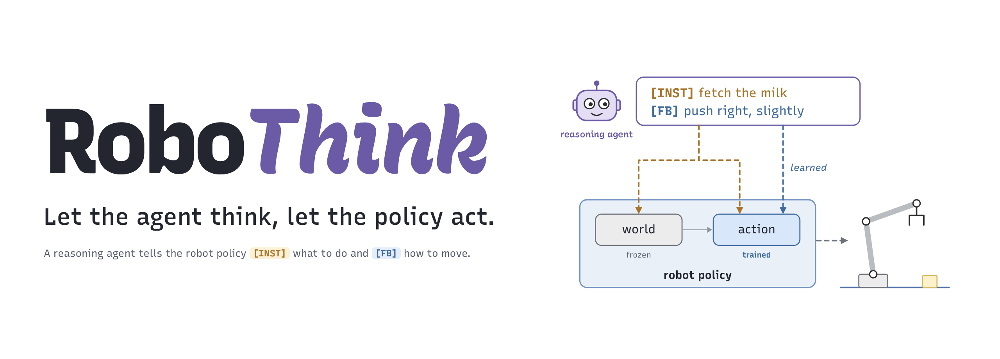

A reasoning agent watches the robot and talks to its policy through two channels: `[INST]` tells it what to do, and `[FB]` tells it how to move. The agent thinks, the policy acts.

- Project page: [robo-think.github.io](https://robo-think.github.io)
- Code: [robo-think/RoboThink](https://github.com/robo-think/RoboThink)
- Paper: [arXiv:2611.30111](https://arxiv.org/abs/2611.30111)
